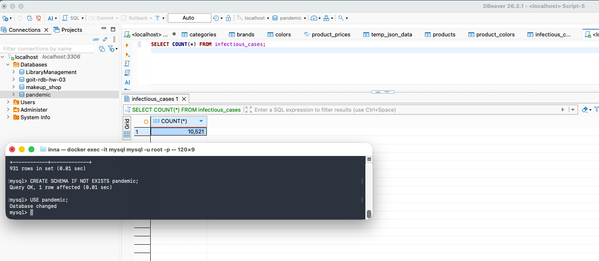
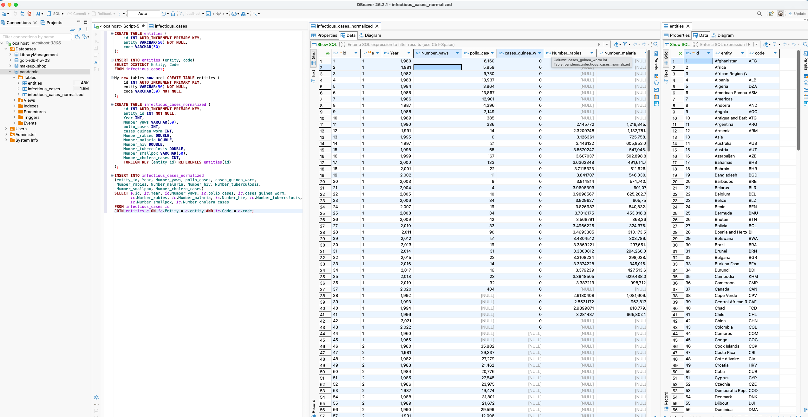
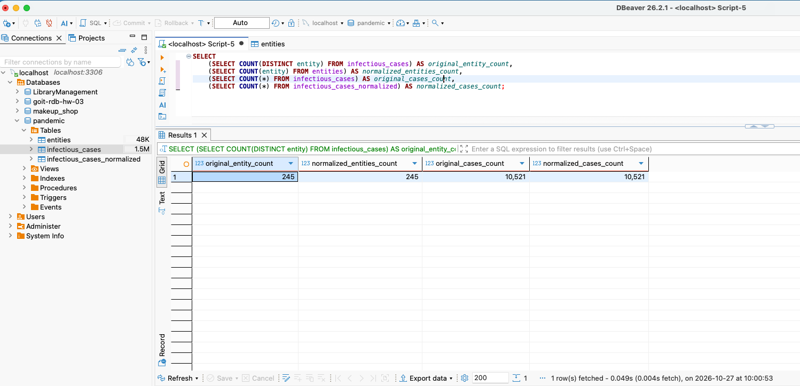
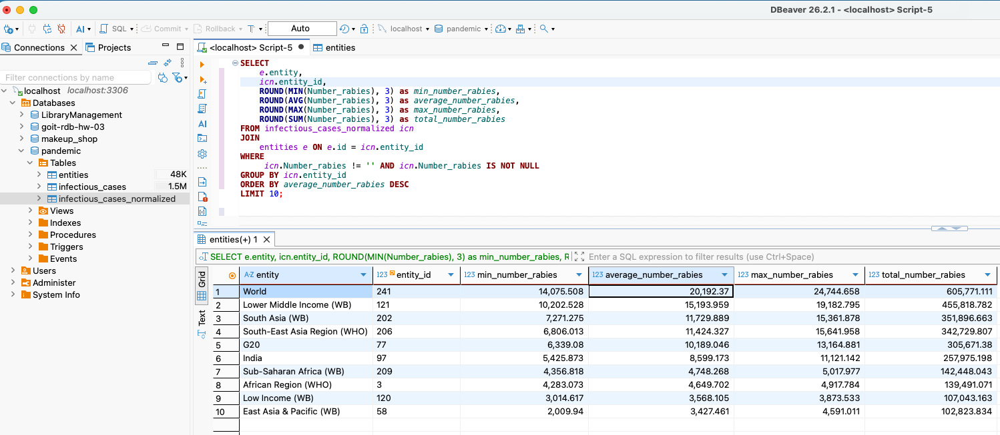
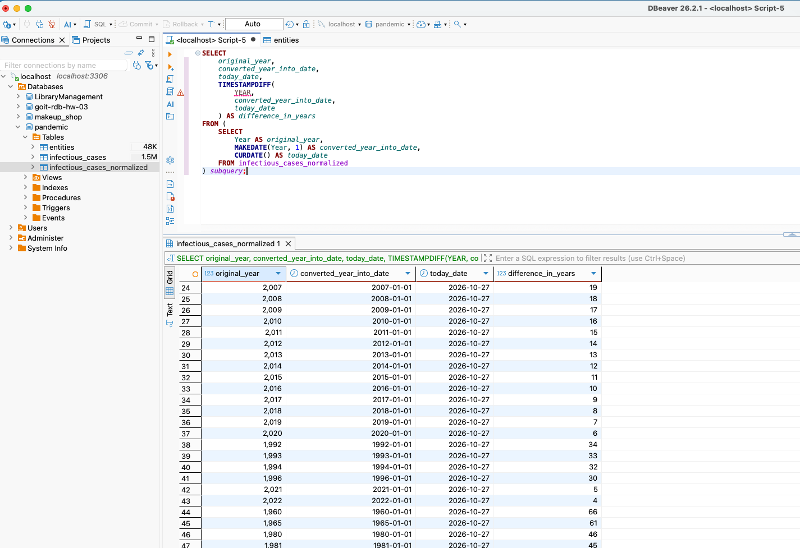
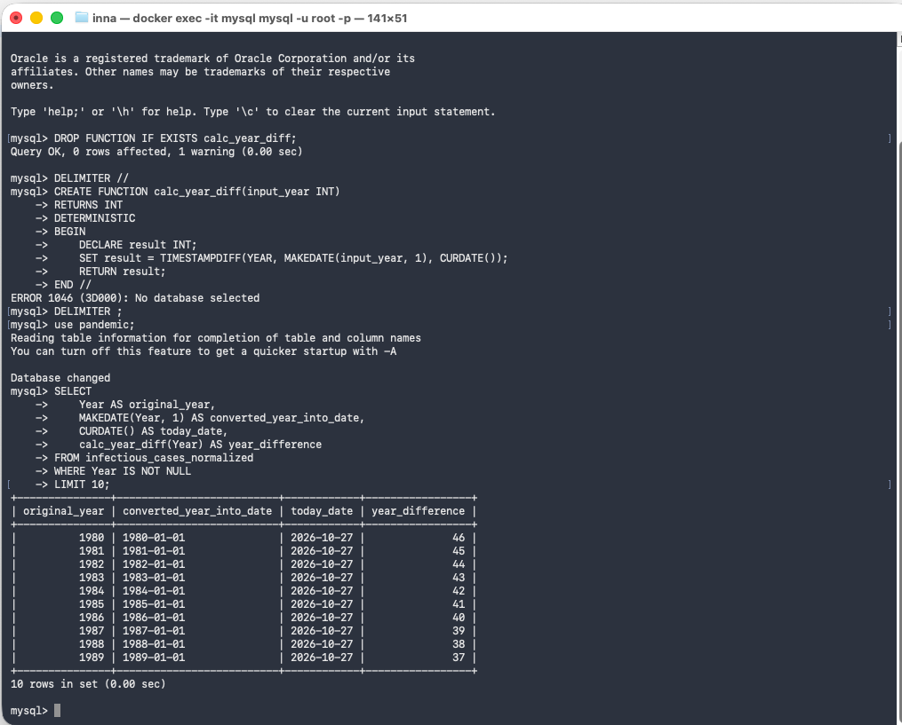

# SQL Final Project: Pandemic Data Analysis

## Tasks and Results

### Task 1: Data Loading
**Description:** Create pandemic schema and import infectious_cases data from CSV file using MySQL Import wizard.

**Screenshot of the result**

### Task 2: Database Normalization
**Description:** Normalize the infectious_cases table to 3NF by splitting it into entities and infectious_cases_normalized tables. Verify that the normalization preserved all data records.

**Screenshot of the result**

**Result:** 245 | 245 | 10521 | 10521 - All counts match, normalization successful.

### Task 3: Data Analysis
**Description:** For each unique combination of Entity and Code (or their IDs), calculate the average, minimum, maximum, and sum for the Number_rabies attribute. Filter out empty values ('') from Number_rabies. Sort results by average in descending order and display only top 10 rows.

**Screenshot of the result**

### Task 4: Date Calculations
**Description:** Create date difference columns using SQL functions to analyze time spans in the data.

**Screenshot of the result**

### Task 5: Custom Function
**Description:** Create and use a custom function that:
- Takes a year value as input
- Returns the difference in years between current date and January 1st of that year
- Uses TIMESTAMPDIFF() and MAKEDATE() functions internally
- Includes DETERMINISTIC declaration for MySQL compatibility

**Screenshot of the result**

## Folder Structure
- `results/` - Contains screenshots and output files for each step
- `sql_queries.txt` - Documentation of all SQL commands executed

## Database
- MySQL database
- Schema: pandemic
- Main tables: infectious_cases, entities, infectious_cases_normalized
